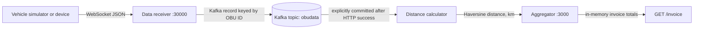

# FleetToll Engine

FleetToll Engine is a Go backend portfolio project exploring reliable telemetry processing for commercial fleets. Vehicles send GPS points; the backend validates and buffers them, calculates per-vehicle travel distance, and aggregates that distance into a simple invoice view.

The current code is an **early-stage prototype**, not a production tolling or billing system. Its strongest implemented areas are bounded WebSocket ingestion, keyed Kafka publishing, geodesic distance calculation, explicit Kafka offset commits, and defensive HTTP contracts. Persistence, authenticated identity, tenant isolation, financial-grade idempotency, toll-zone pricing, and operational observability are not yet implemented.

## Product problem

Fleet operators need a trustworthy record of where vehicles travel and which toll charges should be attributed to each vehicle. A useful backend must handle frequent device events, isolate vehicle state, survive dependency failures, and eventually provide auditable trip and billing records.

This project is being built toward a multi-tenant fleet tolling and revenue-assurance platform. The current increment demonstrates the telemetry-to-distance-to-invoice prototype; it does not yet solve the full business problem.

## Current architecture



### Event flow

1. A device opens `ws://localhost:30000/ws` and sends one JSON telemetry point per text frame.
2. The receiver requires a positive OBU ID and finite latitude/longitude in geographic ranges. It limits each frame to 4 KiB and publishes validated telemetry to Kafka using the OBU ID as the record key.
3. Kafka preserves order for records with the same key within a partition. It does not establish global ordering across partitions.
4. The distance calculator keeps the most recent point for each OBU in a mutex-protected in-memory map and computes a Haversine distance in kilometers.
5. It posts the result to the aggregator. Kafka auto-commit is disabled; the consumer commits a record only after it observes a successful HTTP response.
6. The aggregator validates input and adds distance to a concurrent in-memory store. `GET /invoice?obu=<id>` returns the accumulated distance and a prototype amount.

## Implemented and verified

| Area | Current behavior | Evidence |
|---|---|---|
| WebSocket ingestion | Per-connection handling, bounded frame size, strict JSON fields, coordinate validation, same-origin browser check, reduced sensitive logging | Loopback WebSocket tests, including concurrent clients and invalid/oversized input |
| Kafka producer | Configurable broker/topic, OBU-keyed records, idempotent producer mode, `acks=all`, delivery result handling | Producer unit tests and real-broker integration |
| Distance calculation | Per-OBU state, Haversine kilometers, input validation, mutex protection | Unit and race tests |
| Kafka consumer | Auto-commit disabled; commit after successful downstream response; cancellation-aware polling and client close | Commit-order unit tests and real Kafka-to-HTTP integration |
| Aggregator API | Method/content-type validation, strict bounded JSON, input checks, typed invoice not-found, synchronized in-memory store | HTTP integration tests and concurrency race coverage |
| Aggregator client | JSON contract, five-second default HTTP timeout, context propagation, response-body cleanup | Loopback HTTP contract and timeout tests |

## Known engineering limitations

- Calculator previous-point state and invoice totals are lost on process restart and are not shared between replicas.
- Distance state changes before the aggregator request succeeds. A failed request followed by replay can calculate from an already-advanced in-memory point.
- The aggregator write and Kafka offset commit are separate operations. If the aggregator accepts a write but the response is lost, replay can add the same distance twice. This is **not exactly-once processing**.
- A malformed or invalid Kafka event stops the consumer without committing. This avoids silently discarding it, but can block progress on that partition; retry, DLQ, alerting, and replay tooling are still needed.
- The aggregator API and WebSocket device identity are unauthenticated. An OBU ID supplied by a client is not proof of device ownership.
- The local Kafka Compose listener is plaintext and has no SASL, TLS, or ACL setup. It is for local development only.
- Invoice amount uses floating-point prototype pricing. Currency, integer minor units, immutable invoice evidence, and ledger semantics are not implemented.
- No PostgreSQL/PostGIS, authentication, tenant authorization, toll geofencing, distributed tracing, Prometheus/Grafana, full E2E suite, or measured 1,000-user/device workload exists yet.

Current security assessments and the implementation sequence are in [`docs/security/`](docs/security/) and [`docs/IMPLEMENTATION_ROADMAP.md`](docs/IMPLEMENTATION_ROADMAP.md). They describe open findings as well as completed work.

## Repository layout

```text
aggregator/                 HTTP API, invoice service, in-memory store
data_receiver/              WebSocket endpoint and Kafka producer
distance_calculator/        Kafka consumer, distance service, HTTP client
obu/                        Basic telemetry simulator (known limitations below)
types/                      Shared telemetry, distance, invoice types
docs/architecture/          Accepted engineering decisions (ADRs)
docs/learning/              Feature guides, TDD notes, learning path
docs/security/              Local security reviews and remaining risks
```

## Run locally

Requirements: Go 1.21+, Docker Compose, and a local network that allows loopback HTTP/WebSocket tests. Docker Compose starts the single-node Kafka development dependency; it does not start the Go services.

Start Kafka and Zookeeper:

```bash
docker compose up -d
```

The Go services read process environment variables directly; they do not load `.env` files. The committed `.env.example` documents the Kafka settings, but export them in each terminal if you need non-default values.

Start the aggregator:

```bash
go run ./aggregator -listenaddr :3000
```

Start the distance calculator in another terminal:

```bash
KAFKA_BROKERS=localhost:9092 KAFKA_TOPIC=obudata go run ./distance_calculator
```

Start the WebSocket receiver in another terminal:

```bash
KAFKA_BROKERS=localhost:9092 KAFKA_TOPIC=obudata go run ./data_receiver
```

The current `obu` simulator is not a reliable demo client yet: it can generate out-of-range latitude values and zero OBU IDs, both correctly rejected by the receiver. Use a corrected simulator or a WebSocket client with valid points before expecting invoice totals.

Example telemetry frame:

```json
{"obuID":12345,"lat":23.7806,"long":90.4074}
```

After sending at least two valid points for the same OBU, query the prototype invoice:

```bash
curl "http://127.0.0.1:3000/invoice?obu=12345"
```

First point initializes the baseline and contributes zero kilometers. Subsequent points contribute the great-circle distance from the preceding point for that OBU.

## Configuration

| Variable | Default | Used by |
|---|---|---|
| `KAFKA_BROKERS` | `localhost:9092` | Receiver producer and distance consumer |
| `KAFKA_TOPIC` | `obudata` | Receiver and executable configuration |
| `KAFKA_CONSUMER_GROUP` | `fleettoll-distance-calculator` | Distance consumer |
| `KAFKA_TEST_BROKERS` | `localhost:9092` | Real Kafka integration tests only |

Aggregator defaults to `:3000`; receiver listens on `:30000`; the distance-calculator's aggregator URL is currently `http://127.0.0.1:3000/aggregate`.

## Test and verification

Run unit and loopback integration suites:

```bash
GOCACHE=/tmp/fleettoll-go-cache go test ./...
GOCACHE=/tmp/fleettoll-go-cache go test -race ./...
GOCACHE=/tmp/fleettoll-go-cache go vet ./...
```

Run the named real-broker tests. They create temporary topics and require the local Compose broker:

```bash
GOCACHE=/tmp/fleettoll-go-cache make integration-kafka
```

Focused examples:

```bash
GOCACHE=/tmp/fleettoll-go-cache make tdd PKG=./distance_calculator TEST=TestCalculatorServiceCalculatesHaversineKilometers
GOCACHE=/tmp/fleettoll-go-cache go test ./aggregator -run '^TestAggregatorHTTP' -count=1
GOCACHE=/tmp/fleettoll-go-cache go test ./distance_calculator -run '^TestKafkaConsumer' -count=1
```

### Latest verified results

On 2026-11-15, the following commands completed successfully on the development machine:

- `GOCACHE=/tmp/fleettoll-go-cache go test -race ./...` — all Go packages passed. The macOS linker emitted non-fatal `LC_DYSYMTAB` warnings for two test binaries.
- `GOCACHE=/tmp/fleettoll-go-cache go vet ./...` — passed.
- `GOCACHE=/tmp/fleettoll-go-cache make integration-kafka` — producer and consumer integration passed against the local Compose Kafka broker. The consumer test delivered two real Kafka events through distance calculation to a loopback HTTP aggregator.
- Focused aggregator, WebSocket, producer, consumer, and distance-calculator HTTP-client tests passed during implementation.

These are development checks, not evidence of production availability, security, or scale. No 1,000-user or 1,000-device load run has been performed.

## Engineering decisions and learning path

The current system design is in [`docs/architecture/HLD.md`](docs/architecture/HLD.md) and [`docs/architecture/LLD.md`](docs/architecture/LLD.md). Accepted decisions are recorded as ADRs under [`docs/architecture/decisions/`](docs/architecture/decisions/). Feature guides under [`docs/learning/features/`](docs/learning/features/) explain implementation flow, tests, failure cases, and interview questions. Security reviews under [`docs/security/`](docs/security/) document tested scenarios and unresolved findings. The next hands-on checkpoint is [`docs/learning/NEXT_ENGINEERING_EXERCISES.md`](docs/learning/NEXT_ENGINEERING_EXERCISES.md).

Current decisions worth being able to explain:

1. Why Haversine is more appropriate than subtracting latitude/longitude values as if they were kilometers.
2. Why OBU ID is a Kafka partition key and what ordering that gives.
3. Why producer idempotence does not deduplicate a repeated business event.
4. Why consumer offsets are committed after an observed HTTP success, and how the separate HTTP/Kafka operations still create a duplicate window.
5. Why in-memory trip state means the current result is neither durable nor safe to scale horizontally.

## Current roadmap

1. Complete a hands-on review of Kafka delivery semantics and the in-memory state failure window.
2. Add PostgreSQL/PostGIS migrations and integration-tested durable trip state.
3. Add tenant, fleet, vehicle, device identity and authenticated authorization.
4. Add idempotency/inbox, retry, DLQ, replay, and recovery behavior.
5. Add toll zones, pricing, ledger, immutable invoices, and reconciliation.
6. Add OpenTelemetry, metrics, dashboards, SLOs, and operational alerts.
7. Run threat-oriented security checks, end-to-end scenarios, and measured API/device load workloads.

See the roadmap document for evidence and ordering dependencies.

## Interview preparation

Use the code and test reports to explain the current trade-offs precisely. Be clear that this prototype has no durable database, auth, tenant authorization, or production load evidence. A strong walkthrough follows one record through the WebSocket, Kafka key, consumer commit boundary, Haversine state, and aggregator, then explains what could fail and what the next durable design must change.

This portfolio should reflect work and concepts you can personally explain and demonstrate. Use the learning exercises in the feature guides to build that understanding before presenting a design as your own engineering judgment.
