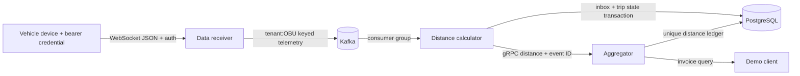
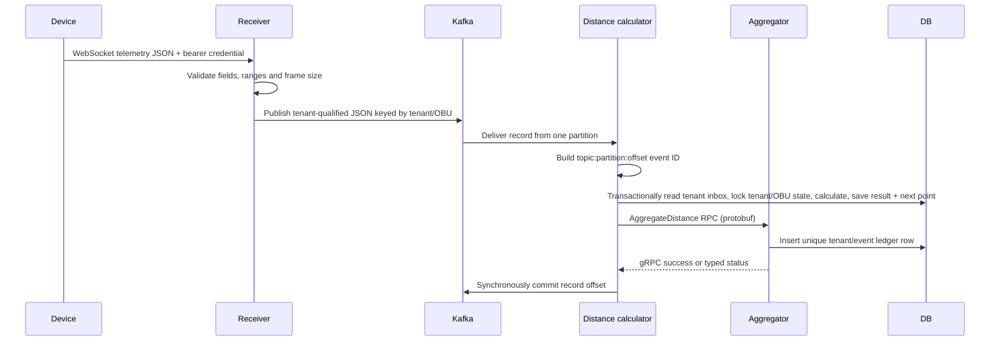

# FleetToll Engine high-level design

**Status:** describes the current prototype as of 2026-11-17. PostgreSQL inbox/trip-state and distance-ledger components are implemented when `DATABASE_URL` is set. The internal calculator-to-aggregator call now uses gRPC; other planned components are not implemented.

## Business purpose

FleetToll is being developed toward a multi-tenant fleet tolling and revenue-assurance platform. Its current backend slice accepts GPS events, computes distance per OBU, and exposes a prototype invoice total. PostgreSQL mode stores a replay-safe inbox and distance ledger; this is not a durable financial billing product.

## System context

## Current component boundaries

| Component | Responsibility | Owns today | Communication |
|---|---|---|---|
| `data_receiver` | Validate an incoming GPS point and publish it | WebSocket connection handling and Kafka producer | WebSocket in; Kafka out |
| Kafka | Buffer and distribute telemetry records | Topic partitions and consumer offsets | Keyed event stream |
| `distance_calculator` | Calculate incremental great-circle distance and return saved result on replay | PostgreSQL `processed_telemetry` and `trip_state` when configured; otherwise memory | Kafka in; gRPC out |
| `aggregator` | Validate/idempotently store distance events and serve prototype invoice totals | PostgreSQL `aggregated_distance_events` when configured; otherwise memory | gRPC internal service; HTTP demo/query API |
| `obu` | Generate sample device traffic | Simulator process | Authenticated WebSocket client; random points are valid-range demo input, not a realistic route |

Tenant isolation and prototype bearer-token authentication are implemented in the telemetry, invoice and internal aggregation paths. A managed identity/auth service, credential rotation, TLS/mTLS, toll zones, a financial invoice ledger, reconciliation and tracing/metrics are not implemented. PostgreSQL currently stores telemetry processing state and distance events only.

## Event workflow

If aggregation returns an error, the consumer stops without committing the record. With PostgreSQL configured, replay returns the saved distance and the tenant-scoped unique aggregate ledger prevents duplicate totals after an ambiguous gRPC outcome. A malformed record or conflicting event ID can still block its partition because retry/DLQ and operator replay are not implemented.

## Data ownership and consistency

- Kafka is the durable event buffer. The producer uses `tenantID:OBUID` as the key; same tenant/vehicle records are assigned to one partition.
- PostgreSQL mode commits the processed-event result and next OBU coordinate in one transaction. A tenant-qualified transaction-scoped advisory lock serializes the read/modify/write for one tenant/OBU.
- The aggregator's event ID primary key makes a distance contribution unique; invoice totals sum the accepted ledger rows.
- Kafka offset commit, PostgreSQL processing and gRPC aggregation do not share one transaction. This is at-least-once delivery with idempotent database effects, not exactly-once processing or financial billing.
- If `DATABASE_URL` is unset, both services use volatile in-memory stores and restart-safe behavior does not apply.

The internal RPC uses the versioned source contract at `api/fleettoll/v1/aggregator.proto`, generated Go bindings and a service bearer token. The transport remains plaintext and should bind only to loopback. The receiver authenticates device bearer credentials, checks OBU allowlists and assigns tenant identity server-side. Invoice HTTP reads authenticate tenant credentials; aggregate HTTP and internal gRPC require the service token. Database primary keys, queries and invoice totals include tenant scope. Tenant 1 is seeded for migration compatibility; other tenant rows are manually provisioned. PostGIS is planned for toll-zone geometry, but no spatial schema exists yet.

## Scaling and operations

Kafka partitions can distribute different tenant/OBU keys across consumer instances. Per-tenant/OBU ordering is partition-scoped. PostgreSQL shares state across replicas and the tenant-qualified advisory lock protects one tenant/OBU state during rebalances. The consumer handles one record at a time per instance and downstream gRPC latency applies backpressure. No production benchmark establishes a gRPC capacity advantage over HTTP.

The local Compose setup uses a single plaintext Kafka broker and ZooKeeper plus PostgreSQL 15 bound to localhost. It is suitable for local integration checks only. There are no production broker replicas, database backup policy, autoscaling policy, service metrics or traces.

## Security boundaries

- WebSocket payloads are bounded and validated. Device credentials establish tenant identity and constrain accepted OBU IDs; the client still supplies an OBU ID within that allowlist.
- Authentication is shared-secret prototype authentication. No automatic provisioning, rotation, TLS/mTLS, per-service identity, revocation or audit trail exists; compatibility fallback maps legacy missing tenant IDs to tenant 1.
- The gRPC listener defaults to loopback and uses plaintext transport plus a shared service token; changing the bind address can expose credentials and service operations to network interception.
- Kafka has no TLS/SASL credentials or ACLs in the local environment.
- Same-origin validation is a browser defense, not device authentication.
- No TLS termination, rate/connection quotas, credential lifecycle, or audit trail is deployed.

These are open findings in `docs/security/`; no external penetration test is claimed.

## Intended evolution

1. Managed device and operator identity, secret rotation, TLS/mTLS, audit events, rate limits and removal of tenant-1 compatibility fallbacks.
2. Bounded retry, DLQ and operator replay.
3. PostGIS toll polygons, tariff versions, toll assessment, integer-minor-unit ledger and immutable invoices.
4. Reconciliation workflows, OpenTelemetry, Prometheus/Grafana, SLOs, end-to-end tests, and measured load.

Each step depends on real integration and security evidence; the diagram above remains the source of truth until those components exist.
