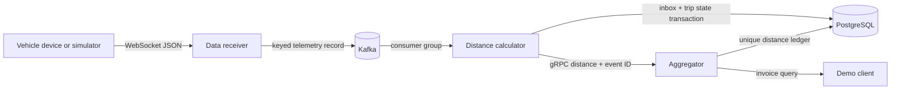
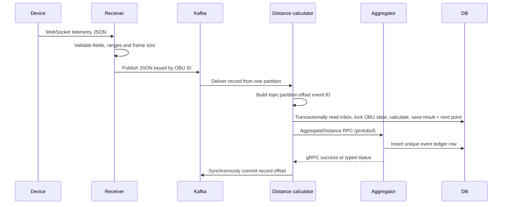

# FleetToll Engine high-level design

**Status:** describes the current prototype as of 2026-11-16. PostgreSQL inbox/trip-state and distance-ledger components are implemented when `DATABASE_URL` is set. The internal calculator-to-aggregator call now uses gRPC; other planned components are not implemented.

## Business purpose

FleetToll is being developed toward a multi-tenant fleet tolling and revenue-assurance platform. Its current backend slice accepts GPS events, computes distance per OBU, and exposes a prototype invoice total. PostgreSQL mode stores a replay-safe inbox and distance ledger; this is not a durable financial billing product.

## System context

## Current component boundaries

| Component | Responsibility | Owns today | Communication |
|---|---|---|---|
| `data_receiver` | Validate an incoming GPS point and publish it | WebSocket connection handling and Kafka producer | WebSocket in; Kafka out |
| Kafka | Buffer and distribute telemetry records | Topic partitions and consumer offsets | Keyed event stream |
| `distance_calculator` | Calculate incremental great-circle distance and return saved result on replay | PostgreSQL `processed_telemetry` and `trip_state` when configured; otherwise memory | Kafka in; gRPC out |
| `aggregator` | Validate/idempotently store distance events and serve prototype invoice totals | PostgreSQL `aggregated_distance_events` when configured; otherwise memory | gRPC internal service; HTTP demo/query API |
| `obu` | Generate sample device traffic | Simulator process | WebSocket client; current random coordinate generator needs correction |

Tenant and auth services, toll zones, a financial invoice ledger, reconciliation and tracing/metrics are not implemented. PostgreSQL currently stores telemetry processing state and distance events only.

## Event workflow

If aggregation returns an error, the consumer stops without committing the record. With PostgreSQL configured, replay returns the saved distance and the unique aggregate ledger prevents duplicate totals after an ambiguous HTTP outcome. A malformed record or conflicting event ID can still block its partition because retry/DLQ and operator replay are not implemented.

## Data ownership and consistency

- Kafka is the durable event buffer. The producer uses OBU ID as the key; same-key records are assigned to one partition.
- PostgreSQL mode commits the processed-event result and next OBU coordinate in one transaction. A transaction-scoped advisory lock serializes the read/modify/write for one OBU.
- The aggregator's event ID primary key makes a distance contribution unique; invoice totals sum the accepted ledger rows.
- Kafka offset commit, PostgreSQL processing and gRPC aggregation do not share one transaction. This is at-least-once delivery with idempotent database effects, not exactly-once processing or financial billing.
- If `DATABASE_URL` is unset, both services use volatile in-memory stores and restart-safe behavior does not apply.

The internal RPC uses the versioned source contract at `api/fleettoll/v1/aggregator.proto`, with generated Go bindings checked in and a local-only insecure transport. The HTTP endpoints remain for manual inspection. Tenant, fleet, vehicle, and device records must establish server-side identity before tenant authorization is claimed. PostGIS is planned for toll-zone geometry, but no spatial schema exists yet.

## Scaling and operations

Kafka partitions can distribute different OBU keys across consumer instances. Per-OBU ordering is partition-scoped. PostgreSQL shares state across replicas and the advisory lock protects an OBU during rebalances. The consumer handles one record at a time per instance and downstream gRPC latency applies backpressure. No production benchmark establishes a gRPC capacity advantage over HTTP.

The local Compose setup uses a single plaintext Kafka broker and ZooKeeper plus PostgreSQL 15 bound to localhost. It is suitable for local integration checks only. There are no production broker replicas, database backup policy, autoscaling policy, service metrics or traces.

## Security boundaries

- WebSocket payloads are bounded and validated, but the device supplies its own OBU ID and is not authenticated.
- The aggregator has no authentication or tenant authorization.
- The gRPC listener defaults to loopback and uses plaintext credentials; changing the bind address can expose unauthenticated RPCs to a network.
- Kafka has no TLS/SASL credentials or ACLs in the local environment.
- Same-origin validation is a browser defense, not device authentication.
- No TLS termination, rate/connection quotas, credential lifecycle, or audit trail is deployed.

These are open findings in `docs/security/`; no external penetration test is claimed.

## Intended evolution

1. Authenticated device and user identity, tenant authorization, audit events and rate limits.
2. Bounded retry, DLQ and operator replay.
4. PostGIS toll polygons, tariff versions, toll assessment, integer-minor-unit ledger and immutable invoices.
5. Reconciliation workflows, OpenTelemetry, Prometheus/Grafana, SLOs, end-to-end tests, and measured load.

Each step depends on real integration and security evidence; the diagram above remains the source of truth until those components exist.
