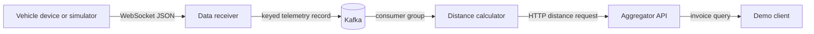
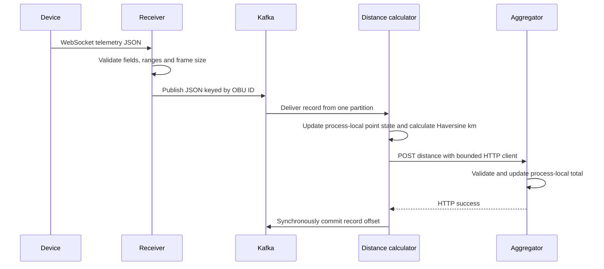

# FleetToll Engine high-level design

**Status:** describes the current prototype as of 2026-11-15. Planned components are labeled; they are not implemented.

## Business purpose

FleetToll is being developed toward a multi-tenant fleet tolling and revenue-assurance platform. Its current backend slice accepts vehicle GPS events, computes distance per OBU, and exposes an in-memory invoice total. This slice proves the basic event path and selected reliability boundaries; it is not a durable billing product.

## System context

## Current component boundaries

| Component | Responsibility | Owns today | Communication |
|---|---|---|---|
| `data_receiver` | Validate an incoming GPS point and publish it | WebSocket connection handling and Kafka producer | WebSocket in; Kafka out |
| Kafka | Buffer and distribute telemetry records | Topic partitions and consumer offsets | Keyed event stream |
| `distance_calculator` | Calculate incremental great-circle distance per OBU | In-memory last point per OBU | Kafka in; HTTP out |
| `aggregator` | Validate and accumulate distances; serve invoice totals | In-memory per-OBU totals | HTTP API |
| `obu` | Generate sample device traffic | Simulator process | WebSocket client; current random coordinate generator needs correction |

There is no database, tenant service, auth service, toll-zone service, invoice ledger, reconciliation service, or tracing/metrics backend in the current system.

## Event workflow

If aggregation returns an error, the consumer stops without committing the record. A malformed record also stops without commit and can block its partition. The failure is visible, but retry/DLQ and operator replay are not yet available.

## Data ownership and consistency

- Kafka is the only durable component in the current flow. The producer uses the OBU ID as key; same-key records are assigned to the same partition under the default partitioner.
- The distance calculator updates its in-memory prior point before its HTTP call. A process crash loses this map; a downstream failure may leave it ahead of Kafka's committed offset.
- The aggregator updates its in-memory total before returning success. A lost HTTP response can make the consumer replay a record that the aggregator already applied.
- Kafka offset commit and HTTP aggregation are not a shared transaction. The current path is at-least-once in intent, with duplicate and loss windows due to volatile state. It is not exactly-once or financially safe.

The next architecture step is to persist event identity and trip state in PostgreSQL, then make the aggregation write idempotent. Tenant, fleet, vehicle, and device records must establish server-side identity before tenant authorization is claimed. PostGIS is planned for toll-zone geometry, but no spatial schema exists yet.

## Scaling and operations

Kafka partitions can distribute different OBU keys across consumer instances. Per-OBU ordering is partition-scoped. The current state map is process-local, so rebalancing one OBU to another consumer loses its baseline. The consumer handles one record at a time per instance and downstream HTTP latency applies backpressure.

The local Compose setup uses a single plaintext Kafka broker and ZooKeeper. It is suitable for local integration checks only. There are no health-based startup dependencies, production broker replication, Postgres pool, autoscaling policy, service metrics, traces, or measured throughput results.

## Security boundaries

- WebSocket payloads are bounded and validated, but the device supplies its own OBU ID and is not authenticated.
- The aggregator has no authentication or tenant authorization.
- Kafka has no TLS/SASL credentials or ACLs in the local environment.
- Same-origin validation is a browser defense, not device authentication.
- No TLS termination, rate/connection quotas, credential lifecycle, or audit trail is deployed.

These are open findings in `docs/security/`; no external penetration test is claimed.

## Intended evolution

1. PostgreSQL migrations and repositories for tenant-scoped fleets/vehicles and durable trip state.
2. Authenticated device and user identity, tenant authorization, audit events, and rate limits.
3. Transactional inbox/idempotency plus bounded retry, DLQ, and replay operations.
4. PostGIS toll polygons, tariff versions, toll assessment, integer-minor-unit ledger and immutable invoices.
5. Reconciliation workflows, OpenTelemetry, Prometheus/Grafana, SLOs, end-to-end tests, and measured load.

Each step depends on real integration and security evidence; the diagram above remains the source of truth until those components exist.
