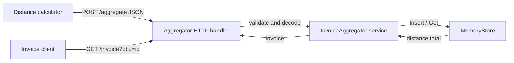
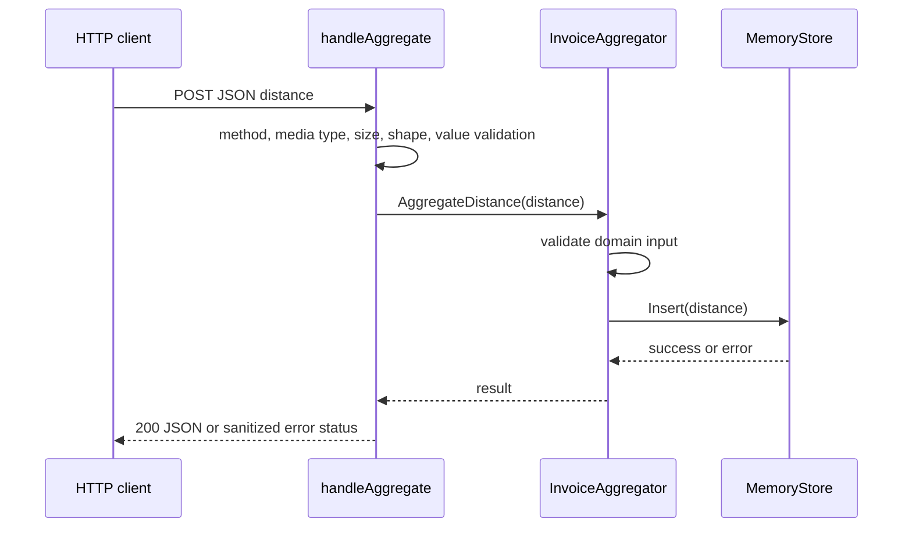

# Feature 02: Aggregator HTTP boundary

## Business requirement

Distance processing sends accumulated kilometers to the aggregator, and fleet users need invoice totals. The API must reject malformed or unreasonable requests before changing those totals, return consistent HTTP responses, and remain safe when multiple requests arrive concurrently.

**Current status:** this guide documents the retained HTTP adapter for manual use and compatibility. The Kafka consumer now uses generated protobuf/gRPC; see [Feature 08](08-protobuf-grpc-aggregator.md) and ADR-022 for the active internal path.

## HLD

This is still one aggregator process with in-memory storage. The `MemoryStore` is a demonstration adapter, not durable persistence.

## LLD and API contract

- `newHTTPHandler` builds the production `http.ServeMux`, making the route wiring reusable in tests.
- `handleAggregate` accepts only POST with `application/json`. It caps bodies at 1 MiB, rejects unknown fields and multiple JSON values, and requires a positive OBU ID, finite non-negative distance, and positive Unix timestamp.
- On success, it calls `Aggregator.AggregateDistance` and returns HTTP 200 JSON `{"status":"aggregated"}` to preserve the existing client expectation.
- `handleGetInvoice` accepts only GET and exactly one positive `obu` query value. A missing OBU returns 404; malformed IDs return 400. Invoice JSON is marked `Cache-Control: no-store`.
- `writeJSON` sets the media type before committing the status code.
- `InvoiceAggregator` returns wrapped storage errors instead of panicking. `ErrInvoiceNotFound` gives the transport a stable not-found classification.
- `MemoryStore` uses an RWMutex: inserts take the exclusive lock, reads take a shared lock. This protects the Go map but does not add durability or cross-process consistency.

## Decisions and failure behavior

The handler keeps the existing endpoint names and success status because the distance-calculator client expects HTTP 200. Strict field decoding prevents silently ignored fields such as a client-supplied `tenantID`; it does not authenticate the OBU identity. A store failure returns a generic 500 to the client while the service preserves the wrapped cause for internal handling. Unknown invoices map to 404. If the process restarts, the memory store loses totals.

Alternatives and the detailed decision are in [ADR-016](../../architecture/decisions/ADR-016-aggregator-http-boundary.md).

## TDD and tests

RED used loopback HTTP requests against the previous handlers. Tests failed because wrong methods were accepted, unknown and trailing JSON passed, content type was ignored, invalid distances were inserted, oversized bodies were processed, invalid invoice IDs returned 500, missing invoices returned 500, response content type was absent, and storage failure panicked the server (connection ended with EOF).

GREEN implemented the bounded strict handlers, typed not-found behavior, error returns and synchronized store. Tests then passed against `newHTTPHandler` using a real `httptest.NewServer` loopback listener and the real in-process service/store.

Commands and actual results:

- `GOCACHE=/tmp/fleettoll-go-cache go test -vet=off ./aggregator -run 'TestAggregatorHTTP' -count=1` — RED as expected after the tests were first written (requires loopback bind permission).
- `GOCACHE=/tmp/fleettoll-go-cache go test ./aggregator -run 'TestAggregatorHTTP' -count=1` — passed after implementation.
- `GOCACHE=/tmp/fleettoll-go-cache go test -race ./...` — passed, including 40 concurrent aggregate requests and the distance suite; macOS linker emitted a non-fatal `LC_DYSYMTAB` warning.
- `GOCACHE=/tmp/fleettoll-go-cache go vet ./...` — passed.

## Security review

Automated adversarial cases sent wrong methods, missing/unsupported media types, malformed JSON, unknown fields, trailing JSON, a body larger than 1 MiB, negative distance, zero/repeated OBU IDs and an unknown invoice ID. They were rejected with 405, 415, 400, 413 or 404 as appropriate. A failing storage adapter was exercised; it returns 500 without crashing the server. Concurrent writes were checked under the race detector.

**Open finding FT-API-001 — high severity:** the API has no authentication or tenant authorization. A client able to reach `:3000` can submit arbitrary distances for a guessed OBU ID and read invoice totals for any OBU. Regression tests proving auth are not yet implemented; fix belongs to the upcoming identity/tenant authorization feature. No scanner or external penetration test was run. This feature is not security-complete.

SQL injection does not apply to this in-memory store, and no SQL layer exists here. Do not infer database security from these tests.

## Performance and limitations

Forty concurrent HTTP aggregate requests were exercised for correctness under the race detector. This is a concurrency test, not a benchmark: no requests-per-second, latency percentiles, CPU, memory, or 1,000-user measurements were collected. Store operations are O(1) map updates but serialize writers behind one mutex. Data is lost on restart.

## Interview explanation

In two minutes, explain that the HTTP boundary is responsible for protocol validation and resource limits, while the service independently enforces domain invariants. The adapter returns stable HTTP semantics; the storage adapter stays hidden behind a small interface. An RWMutex is sufficient only for one process and volatile state. Durable multi-instance operation needs PostgreSQL transactions and idempotency, and safe user access needs tenant-scoped identity.

Questions to practice:

1. Why limit request bytes before JSON decoding?
2. Why reject unknown fields and trailing JSON?
3. Why is a mutex around a Go map not a persistence strategy?
4. How would PostgreSQL uniqueness constraints prevent duplicate toll charges?
5. What authorization context should replace the client-controlled OBU ID?

## Exercise

Add a table-driven test for fractional `obu` query strings, overflow-sized integers and malformed percent encoding. Then propose a tenant-aware invoice API where tenant identity comes from verified auth context, not from a query parameter.
