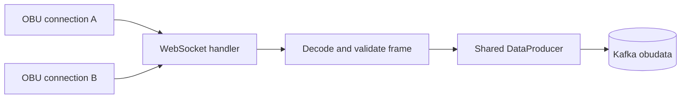
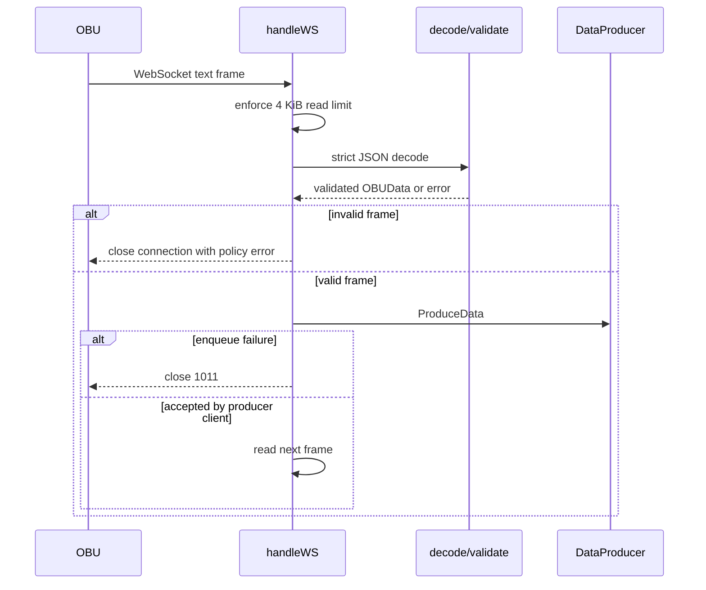

# Feature 03: WebSocket telemetry ingestion

## Business requirement

OBU devices stream GPS coordinates to FleetToll. A malformed, oversized, spoofed or cross-routed frame can corrupt trip calculations or consume server resources. Each connection must be isolated, inputs validated, and disconnects must end their read loop.

## HLD

The WebSocket handler has connection-local socket and decoder state. The producer is shared. In tests, a recording producer replaces Kafka; real broker delivery is a separate integration gate.

## LLD and protocol

- `newWebSocketHandler` owns the `/ws` route; production and tests use the same handler wiring.
- `DataReceiver` contains only `DataProducer`. It no longer stores the current client connection.
- `handleWS` upgrades a request, sets `maxOBUMessageBytes` to 4096, reads text frames in the handler goroutine, and returns on close/read failure.
- `decodeOBUData` uses pointer fields so missing `lat`/`long` is distinct from a valid zero coordinate. It rejects unknown fields and trailing JSON.
- `validateOBUData` requires a positive ID, finite latitude in `[-90,90]`, and finite longitude in `[-180,180]`.
- Origin headers must match host and scheme. Missing Origin is accepted for native clients; this is not device authentication.
- Invalid frames close with protocol/policy codes. Producer enqueue errors close with 1011. Valid messages currently receive no application-level acknowledgment.
- The producer logging middleware logs duration only; GPS and OBU identifiers are omitted.

## TDD, unit and integration evidence

RED command: `GOCACHE=/tmp/fleettoll-go-cache go test -vet=off ./data_receiver -run '^TestWebSocketRejectsInvalidCoordinates$' -count=1`.

The previous implementation accepted latitude 91 and passed it to the producer. After the test closed the connection, the detached reader repeatedly read the failed socket and panicked with `repeated read on failed websocket connection`. A second RED test showed that a missing longitude silently became `0` and reached the producer.

GREEN tests use real WebSocket handshakes and frames against an `httptest.Server`. They verify valid messages from two simultaneously connected clients, invalid and missing coordinates, unknown fields, oversized frames, cross-origin rejection, clean closure and absence of sensitive log fields.

- `GOCACHE=/tmp/fleettoll-go-cache go test ./data_receiver -count=1` — passed.
- `GOCACHE=/tmp/fleettoll-go-cache make tdd PKG=./data_receiver TEST=TestWebSocketRejectsInvalidCoordinates` — passed.
- `GOCACHE=/tmp/fleettoll-go-cache go test -race ./...` — passed; HTTP/WebSocket packages emitted non-fatal macOS linker `LC_DYSYMTAB` warnings.
- `GOCACHE=/tmp/fleettoll-go-cache go vet ./...` — passed.

## Independent security review

Cross-origin browser upgrade was rejected with HTTP 403. Invalid coordinate, missing field, unknown field and over-limit frame cases did not reach the producer. Logs were tested to exclude OBU ID and coordinate values.

Open findings are recorded in [WEBSOCKET_REVIEW.md](../../security/WEBSOCKET_REVIEW.md). Highest risk is unauthenticated device identity: any client can omit Origin and submit a different OBU ID. No external scanner or penetration test was run. TLS, per-device rate limits and connection quotas are also absent.

## Performance and reliability limits

Two simultaneous connections were exercised for correctness under `-race`; no 1,000-connection workload, throughput, latency, CPU, memory or Kafka lag was measured. Frame size is bounded but connections and per-device message rate are not. `ProduceData` success currently means client enqueue accepted the message, not broker delivery confirmed. There is no graceful shutdown/drain policy or reconnect protocol.

## Interview explanation

Explain the original cross-connection bug: a service-wide `Conn` pointer meant all reader goroutines could observe the most recently accepted socket. Moving the socket into the handler's local variable gives each request its own lifetime. The shared producer remains concurrency-safe at the Kafka client boundary, while per-frame validation happens before serialization. Origin checks protect browser contexts but do not authenticate headless devices; a real system needs device credentials and identity-to-vehicle binding.

Practice questions:

1. Why keep the socket inside the handler instead of a service field?
2. Why use pointer fields while decoding coordinates?
3. What does a 4 KiB read limit protect, and what does it not protect?
4. Does a successful Kafka `Produce` mean the broker durably stored the event?
5. Why is Origin validation not authentication?

## Exercise

Add per-device monotonic sequence numbers and a replay-rejection policy. Write the test first, then decide where sequence state belongs so it remains correct across reconnects and service restarts.
