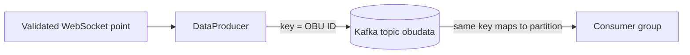

# Feature 04: Kafka telemetry producer

## Business requirement

GPS points need a durable buffer between device ingestion and trip processing. Kafka lets the receiver and calculator scale independently and permits replay from retained events. The producer must surface broker failures and keep one vehicle's records ordered within Kafka's partition model.

## HLD

## LLD

- `kafkaBrokersFromEnv` reads `KAFKA_BROKERS`, defaulting to `localhost:9092`.
- `kafkaTopicFromEnv` reads `KAFKA_TOPIC`, defaulting to `obudata`.
- `NewKafkaProducer` rejects an empty topic, configures `enable.idempotence=true`, `acks=all`, and a 15-second message timeout, then starts an event-reader goroutine.
- `ProduceData` validates OBU ID and coordinates, JSON-encodes the point, sets record `Key` to the decimal OBU ID, enqueues the message, and waits for the per-record delivery event.
- Same-key messages map to the same partition under Kafka's default keyed partitioner. Kafka preserves order in one partition; it does not impose order across partitions.
- `Close` flushes outstanding messages and closes the Confluent client. The receiver process does not yet implement a full graceful shutdown path that guarantees this method is called after all WebSocket connections stop.
- The `integration` build-tag test creates a unique temporary topic and uses a real consumer to assert the key and JSON payload.

## TDD and verification

RED: the first broker integration test compiled after adapting cleanup, then failed because the received record key was empty (`record key = "", want OBU ID 8142`). This reproduced the missing partition-key behavior against a real broker.

GREEN:

- `GOCACHE=/tmp/fleettoll-go-cache go test ./data_receiver -run '^TestKafkaProducer' -count=1` — passed unit tests for environment defaults/overrides, empty topic and pre-broker payload validation.
- `KAFKA_TEST_BROKERS=localhost:9092 GOCACHE=/tmp/fleettoll-go-cache go test -tags=integration ./data_receiver -run '^TestKafkaProducerDeliversKeyedTelemetry$' -count=1 -timeout=60s` — passed against the local Kafka Compose broker.
- `GOCACHE=/tmp/fleettoll-go-cache make integration-kafka` — passed against the real broker.
- `GOCACHE=/tmp/fleettoll-go-cache go test -race ./...` — passed for the repository before this producer slice; rerun after producer modifications is recorded in the latest session validation.
- `GOCACHE=/tmp/fleettoll-go-cache go vet ./...` — passed before this producer slice; rerun after producer modifications is recorded in the latest session validation.

## Security review

Invalid device IDs and coordinates are rejected before Kafka access. Logs omit device identity and coordinates. The local broker has no TLS, SASL or ACLs. A malicious network client with broker access can publish or consume telemetry, and a WebSocket client can still spoof another OBU until device authentication is implemented. Idempotent producer mode does not reject distinct duplicate events.

No broker load test was run; one integration record was produced and read. No throughput or latency benchmark is claimed. `ProduceData` blocks the per-connection read loop until broker acknowledgment (or timeout), providing simple backpressure but limiting per-socket throughput.

## Interview explanation

Explain that Kafka's key selects partition affinity. Choosing OBU ID lets one vehicle's events be ordered, while different vehicles can be processed in parallel. `acks=all` and idempotence strengthen producer delivery but do not make the entire pipeline exactly once. A timeout is an ambiguous outcome, so downstream consumer idempotency remains required.

Practice questions:

1. What ordering does Kafka guarantee, and at what scope?
2. What does idempotent producer mode prevent?
3. Why is `Produce` return not equivalent to broker acknowledgment?
4. What happens if delivery acknowledgment times out after broker acceptance?
5. How would adding partitions change key distribution and ordering assumptions?

## Exercise

Add a configurable compression mode and compare broker throughput and CPU against the uncompressed producer using a repeatable workload. Record p50/p95 acknowledgment latency and verify payload equivalence; do not report results until measured.
