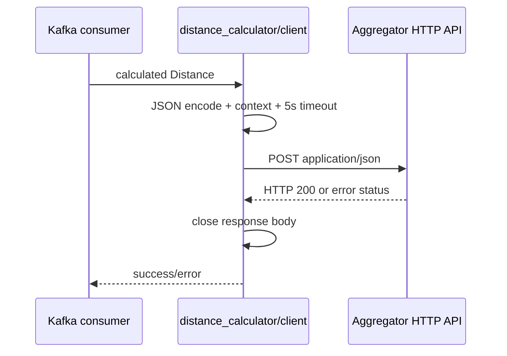

# Feature 05: Distance-calculator HTTP client

**Current status:** this HTTP client remains a tested compatibility utility, while the Kafka consumer's active path uses the generated gRPC client. See [Feature 08](08-protobuf-grpc-aggregator.md).

## Business problem and HLD

After a GPS point is processed, the distance calculator sends the increment to the aggregator. A missing media type now causes HTTP 415; a stuck aggregator can stop message processing; and an unclosed response body can prevent connection reuse.

## LLD

- `Client` holds the endpoint and an injectable `*http.Client`.
- `NewClient` sets a five-second timeout.
- `AggregateInvoiceContext` creates a context-aware POST and sets `Content-Type` and `Accept` to JSON.
- The response body is closed on success and error. Non-200 responses are returned as errors.
- `AggregateInvoice` remains as a compatibility wrapper using a background context.

## TDD and tests

RED command: `GOCACHE=/tmp/fleettoll-go-cache go test ./distance_calculator/client -run '^TestAggregateInvoice' -count=1`.

The test server required `application/json` and returned 415; a response-body tracker also remained open. After the implementation, the same command passed. Tests include actual loopback HTTP request validation, a response close tracker and a 10 ms client timeout against a deliberately delayed handler.

## Security, performance and limits

This guide describes the previous HTTP client, now superseded in the Kafka path by the authenticated protobuf/gRPC client in Feature 08. The retained HTTP aggregate route requires the shared service token; local transport remains plaintext. The request carries an OBU ID and distance. This client’s timeout avoids indefinite waits but a timeout is ambiguous: the server may have accepted the request. This client does not automatically retry. The current durable ledger has event-ID idempotency, but the HTTP compatibility request does not retry and volatile mode is not restart-safe. These HTTP tests do not measure throughput or latency distribution.

## Interview explanation

Explain why an `http.Client` should be reused: it owns connection pooling. Why close response bodies: to return connections to the pool. Why accept context: caller cancellation should flow to I/O. Why not retry timeouts automatically: the server may have processed the POST, so retry without an idempotency key can double-aggregate.

Exercise: compare this HTTP utility with the active gRPC client in Feature 08. Explain what a safe bounded retry policy would require in both transports and what failure policy should apply in volatile mode.
