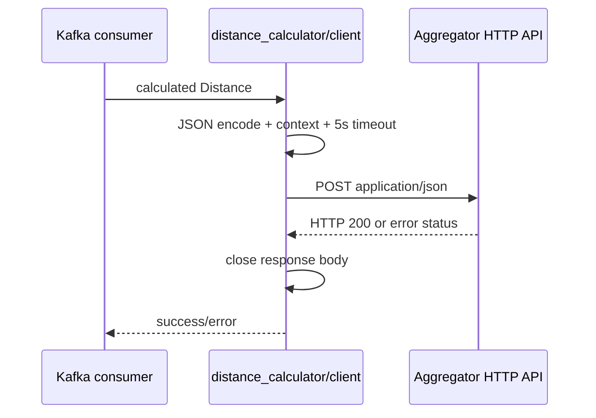

# Feature 05: Distance-calculator HTTP client

## Business problem and HLD

After a GPS point is processed, the distance calculator sends the increment to the aggregator. A missing media type now causes HTTP 415; a stuck aggregator can stop message processing; and an unclosed response body can prevent connection reuse.

## LLD

- `Client` holds the endpoint and an injectable `*http.Client`.
- `NewClient` sets a five-second timeout.
- `AggregateInvoiceContext` creates a context-aware POST and sets `Content-Type` and `Accept` to JSON.
- The response body is closed on success and error. Non-200 responses are returned as errors.
- `AggregateInvoice` remains as a compatibility wrapper using a background context.

## TDD and tests

RED command: `GOCACHE=/tmp/fleettoll-go-cache go test ./distance_calculator/client -run '^TestAggregateInvoice' -count=1`.

The test server required `application/json` and returned 415; a response-body tracker also remained open. After the implementation, the same command passed. Tests include actual loopback HTTP request validation, a response close tracker and a 10 ms client timeout against a deliberately delayed handler.

## Security, performance and limits

The HTTP call is not authenticated and local configuration is plaintext. The request carries an OBU ID and distance. This client’s timeout avoids indefinite waits but a timeout is ambiguous: the server may have accepted the request. There is no automatic retry because downstream idempotency is not implemented. The tests measure no throughput or latency distribution.

## Interview explanation

Explain why an `http.Client` should be reused: it owns connection pooling. Why close response bodies: to return connections to the pool. Why accept context: caller cancellation should flow to I/O. Why not retry timeouts automatically: the server may have processed the POST, so retry without an idempotency key can double-aggregate.

Exercise: add a request ID header and make the aggregator deduplicate by that ID before introducing retry behavior.
