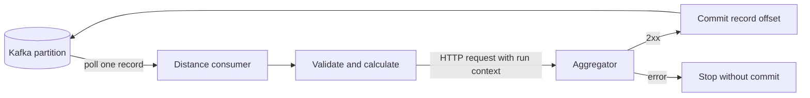

# Feature 06: Kafka consumer lifecycle and explicit offset commits

## Business problem

Telemetry must reach trip processing without the consumer silently advancing past a failed aggregator write. If one GPS event is skipped, distance and eventually toll charges can be wrong. This slice makes the Kafka acknowledgment boundary explicit and lets the process stop cleanly.

## HLD

The consumer owns Kafka polling and offsets. The calculator owns its current in-memory previous coordinate per OBU. The aggregator owns accumulated invoice totals in its in-memory store. These ownership boundaries expose why this flow is not yet crash-safe: neither calculator state nor invoice totals are durable.

## LLD and Go concepts

- `kafkaMessageReader` is a narrow interface containing only `ReadMessage`, `CommitMessage`, `SubscribeTopics` and `Close`. Production passes `*kafka.Consumer`; unit tests use a small fake. This is dependency injection by composition without mocking the entire Kafka library.
- `NewKafkaConsumer` reads `KAFKA_BROKERS` and `KAFKA_CONSUMER_GROUP`; the executable reads `KAFKA_TOPIC`. Auto-commit is disabled. New groups use `auto.offset.reset=earliest`.
- `Start(ctx)` owns `Close`. `run(ctx)` polls for at most 250 ms before it can observe cancellation, so shutdown latency is bounded by one poll plus current processing time.
- `processMessage` decodes telemetry, calculates distance, and passes the context into `AggregateInvoiceContext`. This propagates cancellation to the outbound HTTP request.
- `run` commits only after `processMessage` succeeds. A downstream failure or failed commit ends the process with record topic/partition/offset in the error. It does not keep processing later records in the partition.
- `CommitMessage` is synchronous at this decision boundary. A Kafka commit error may still be ambiguous; if aggregation already succeeded, replay can repeat the aggregation.

## Consistency and failure behavior

This is an at-least-once delivery attempt, not an end-to-end exactly-once guarantee. If Kafka delivered a record and gRPC aggregation succeeded but the response was lost, the consumer does not commit and a later run may repeat that business write. The aggregator's event ledger deduplicates the repeated event ID.

There is a second, more fundamental gap in volatile mode: `CalculateDistance` advances its in-memory previous-point state before gRPC succeeds; a process restart loses the map. Explicit offset commits alone cannot repair this. Durable mode addresses this through a transactional PostgreSQL inbox and trip state, then idempotent aggregation. Kafka, PostgreSQL and gRPC still do not share one transaction, so the guarantee is at-least-once with idempotent effects.

Malformed or invalid records stop the consumer without committing. That avoids silently discarding data, but a poison event can block its partition. A bounded retry/DLQ policy with auditable replay and alerting is required before production.

## TDD and verification

RED: added focused tests for commit only after success, no commit after aggregator failure, and stopping after a commit failure. The first run failed to compile because the injectable reader and run-loop seam were absent; this recorded the missing behavior boundary. After adding it, the tests exercised the ordering and error paths.

GREEN:

- `GOCACHE=/tmp/fleettoll-go-cache go test ./distance_calculator -run '^TestKafkaConsumer' -count=1` — passed with loopback permission. Covers successful aggregation then commit, no commit on HTTP 503, and a failed commit attempt returning an error.
- `GOCACHE=/tmp/fleettoll-go-cache make integration-kafka` — passed against the local Compose Kafka broker. The tagged consumer test creates a unique topic, sends two real Kafka telemetry records, runs the production consumer against a loopback HTTP server, and checks initial distance `0` and next point about `111.195 km`.

The first integration attempt failed because the test canceled the context after the handler signaled receipt but before the HTTP client consumed the response. The test now allows response and commit completion before shutdown; rerun passed. The 300 ms coordination delay is test synchronization, not a production latency claim.

## Security review

Adversarial scenarios exercised: an aggregator HTTP 503 must not result in `CommitMessage`; a Kafka commit error must terminate instead of continuing; malformed JSON returns a processing error and is not acknowledged. The tests confirm these behaviors. The local Kafka broker still has no TLS/SASL/ACL, OBU identity remains caller supplied, and there are no payload quotas, retry budget or DLQ. A party able to publish a malformed record can block its partition. See `docs/security/KAFKA_REVIEW.md`; no external penetration test was performed.

## Performance and concurrency

One record is processed at a time per consumer instance, so partition order is preserved by this serial loop and downstream latency creates backpressure. The 250 ms read timeout bounds idle shutdown responsiveness. No throughput, lag, CPU, heap, goroutine or 1,000-vehicle load measurement was run. Multiple partitions and consumer group members can scale independent partitions, but the current calculator state is process-local; rebalancing an OBU to a different instance can reset its distance baseline.

## Interview explanation

"I disabled auto-commit and explicitly commit each Kafka record only after its downstream gRPC operation succeeds. The loop stops on errors so it cannot advance later offsets past a failed earlier record. This yields replay potential, but the RPC and Kafka offset are separate systems: a lost response can repeat the write. In PostgreSQL mode, the processing inbox and trip baseline commit together, while the aggregate ledger deduplicates the same event ID. Those are separate database effects around a separate Kafka offset, so I call it at-least-once with idempotent database effects, not exactly-once."

Questions to practice:

1. Why can committing after HTTP still produce duplicate billing?
2. What does Kafka commit ordering guarantee within one partition?
3. Why does a fail-stop poison event hurt availability?
4. Why isn't an idempotent Kafka producer enough to deduplicate downstream gRPC side effects?
5. How would you transactionally persist the previous point, event inbox key and distance?

## Exercise

Design a PostgreSQL inbox table keyed by `(consumer_name, event_id)` and a trip-state row keyed by tenant and vehicle. Sketch a transaction that rejects a duplicate event and advances trip state atomically. Then explain how you would keep the HTTP invoice boundary idempotent without claiming a cross-system transaction.
